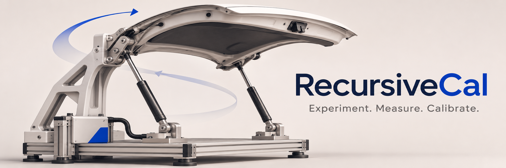

# RecursiveCal

**Can an agent learn to investigate a physical system?**

[](https://github.com/Venkat-RJ/RecursiveCal/actions/workflows/product.yml)
[](https://github.com/Venkat-RJ/RecursiveCal/actions/workflows/verify.yml)
[](https://github.com/Venkat-RJ/RecursiveCal/actions/workflows/research-audit.yml)
[](LICENSE)

RecursiveCal connects a physical simulator to an investigator that chooses experiments, observes the response, updates its belief and commits a calibration. An independent verifier then tests that commitment on new motion profiles. The core is a dimensioned, persistent liftgate rig with CAD replay, instrument observations, bounded tests and an auditable Bayesian baseline.

The [physical inquiry foundation](docs/PHYSICAL_INQUIRY.md) is the main development path. The earlier normalized benchmark, learned-policy pilots, v0.3 release evidence and manuscript remain reproducible research records. The connected physical investigator currently uses Bayesian inference, not a learned RL policy.

[Open recorded workbench](https://venkat-rj.github.io/recursivecal-lab/) · [User guide](docs/USER_GUIDE.md) · [Experiment protocol](docs/EXPERIMENT_PROTOCOL.md) · [Paper draft](paper/README.md) · [Citation](#citation) · [Legacy 3D CAD explorer](https://venkat-rj.github.io/recursivecal/)

The browser preview displays saved release evidence. Running new simulations and fits uses the local Python workbench. The banner is [AI-generated concept artwork](assets/README.md), not a built test rig.

## Start in a clean checkout

Python 3.11 or later:

```bash
git clone https://github.com/Venkat-RJ/RecursiveCal.git
cd RecursiveCal
python -m venv .venv
source .venv/bin/activate
python -m pip install -e .
recursivecal doctor
recursivecal serve
```

Open `http://127.0.0.1:8765`. The server runs in the current terminal; Ctrl+C stops it. NumPy is the only required third-party runtime dependency. The new suite needs no GPU, API key, paid service, or CAD installation.

For the complete physical investigation, open **`http://127.0.0.1:8765/inquiry.html`**, or run:

```bash
recursivecal inquire --case weak_motor --seed 7 --output runs/physical-inquiry.json
recursivecal verify-inquiry runs/physical-inquiry.json
```

The workbench shows the actual diagnostic sequence, belief updates, a sealed calibration, before/after CAD motion and four independent motion checks. A correct diagnosis can still produce a rejected calibration. A model mismatch can trigger a fixture check and abstention. Full reports retain sensor readings, source hashes and evaluator-only truth.

## What you can use now

| Capability | Implemented behavior |
| --- | --- |
| Physical inquiry | Persistent SI plant, observation-only session, adaptive Bayesian tests, fixed/no-probe comparisons, calibration commitment and independent verification |
| CAD investigation view | Authored assembly driven by actual saved traces, decision journal, parameter belief, limits, report import/export and explicit recorded mode |
| SI liftgate simulation | Explicit geometry, gravity, force lag, gas assistance, friction and stiction, stops, sensor assumptions, power loss, and holding architecture |
| Workbench | Configure and run the model, inspect signals, replay time, pin comparisons, import results, export complete JSON and CSV |
| Force fitting | Read SI CSVs with provenance, fit training rows, report held-out residuals, apply a curve only within its measured-length support |
| Trajectory comparison | Compare declared observations against a saved simulation without refitting, time shifting, or extrapolation |
| Diagnostic experiments | Fixed, Bayesian, learned contextual-bandit, shuffled, and abstention policies under a public synthetic protocol |
| Reproducibility | Raw trial records, observations, frozen selection, checkpoints, source hashes, and an artifact verifier |
| Research handoff | Numerical audit, explicit negative results, manuscript source, generated figures, citation file, and measurement protocol |

The connected physical rig, original SI model and normalized diagnostic benchmark have separate identifiers. A policy trained in the normalized benchmark is not presented as a learned liftgate controller. Default physical coefficients and bundled example data are synthetic. **Independent hardware accuracy and safe real-world operation have not been established.**

## Run the workflows

### Simulate and export

```bash
recursivecal simulate --scenario open --duration 6.5 --dt 0.01 \
  --output runs/open.json --csv runs/open.csv
recursivecal simulate --scenario passive_hold --output runs/hold.json
```

The default passive-hold test fails by design: the assumed gas support and hinge stiction cannot hold the hatch open. The run records its speed-limit event and actual early stop. An explicit brake parameter can change the modeled architecture; it is not evidence that a real brake exists or is adequate.

### Fit data and compare a trace

```bash
recursivecal fit-force examples/measurements/synthetic_force.csv \
  --metadata examples/measurements/synthetic_force.metadata.json \
  --output runs/fit.json --parameters-output runs/fitted-parameters.json

recursivecal simulate --parameters runs/fitted-parameters.json \
  --controller-parameters runs/fitted-parameters.json \
  --output runs/fitted-open.json

recursivecal replay examples/measurements/synthetic_trajectory.csv \
  --metadata examples/measurements/synthetic_trajectory.metadata.json \
  --simulation runs/open.json --output runs/comparison.json
```

The example files are labeled synthetic. The same contracts accept actual measurements with declared units and source metadata. A source declaration is retained, not independently authenticated. See [data contracts](docs/DATA_CONTRACT.md) and [physical model assumptions](docs/PHYSICAL_MODEL.md).

### Train, evaluate, and verify

```bash
recursivecal experiment --output runs/smoke --quick
recursivecal verify runs/smoke

recursivecal experiment --output runs/full \
  --train-size 1024 --test-size 512 --seeds 13 37 103 211 509
recursivecal verify runs/full
```

The full recorded release is in [research/releases/v0.3](research/releases/v0.3/). It uses 1,024 training contexts, 512 validation contexts, five learned seeds, and 512 shared test cases in each of five cohorts. The 51,200 policy-by-case records represent 2,560 distinct evaluation cases, not 51,200 independent physical experiments. Quick mode is a software smoke test.

## Recorded research results

Mean net reward is terminal calibration quality minus `0.012 × diagnostic cost`. Higher is better. The learned column is the mean of five fitted seed results.

| Evaluation cohort | No diagnostic test | Fixed schedule | Adaptive Bayes | Learned mean | Bayes with fallback |
| --- | ---: | ---: | ---: | ---: | ---: |
| Constructed finite prior | 0.835115 | 0.877108 | 0.889437 | 0.889164 | 0.885895 |
| Continuous parameter jitter | 0.831377 | 0.870065 | 0.879933 | 0.877946 | 0.874278 |
| Unseen high load | **0.932925** | 0.882169 | 0.895317 | 0.895957 | 0.904224 |
| Extreme deadzone | 0.522092 | 0.509154 | 0.527154 | 0.522354 | 0.512011 |
| Directional-friction shift | 0.809727 | **0.825827** | 0.815906 | 0.813475 | 0.810208 |

Source: [verified summary](research/releases/v0.3/summary.json), [protocol](docs/EXPERIMENT_PROTOCOL.md), and the compressed trial files beside the summary.

On the constructed finite prior, adaptive Bayes improves on the selected fixed schedule by **0.012329**, with a paired 95% interval of **[0.010389, 0.014152]**. Under directional friction, that comparison reverses to **-0.009921 [-0.015302, -0.004964]**. All five learned-versus-Bayes intervals on the finite test include zero; this does not establish equivalence or learned superiority.

The no-test policy chooses the prior-optimal fixed calibration. It is not necessarily a factory setting. A large part of some shifted-cohort differences comes from test cost rather than better calibration quality. Shuffled controls preserve aggregate action cost and are reported descriptively, without an invalid independent-row interval.

The learned policy is a small NumPy contextual bandit with a fixed first test, one optional follow-up, and a shared Bayesian terminal calibrator. It is not LLM RL, long-horizon control, or a general industrial calibration agent. The study is exploratory and was not independently preregistered.

## Physical verification and its limits

The [SI physical audit](research/releases/physical-v1/audit.json) includes explicit numerical gates, geometry/virtual-work checks, energy behavior, step refinement, force fitting, and known failure demonstrations. Nominal opening has about 1.07 degrees simulated tracking RMSE. The default unpowered support balance still lacks about 57.75 Nm after assumed static friction. Passing numerical gates does not turn that failure into a hardware pass.

No OEM model or real actuator dataset was used to train or validate this release. A public NHTSA report motivates the architecture-dependent hold test and is documented in [provenance](docs/PROVENANCE.md); its vehicle measurements are not transferred to this geometry. The [physical measurement protocol](docs/HARDWARE_PROTOCOL.md) specifies the independent evidence needed for a later physical claim.

## Project map

| Path | Purpose |
| --- | --- |
| `recursivecal_lab/` | Installable workbench, SI model, data fitting, experiment runner, and CLI |
| `research/releases/` | Current raw evidence, checkpoints, physical audit, and descriptive inference timings |
| `paper/` | Working manuscript, bibliography, generated figures, and PDF |
| `docs/` | Usage, architecture, model/data contracts, provenance, and experiment protocol |
| `examples/measurements/` | Runnable synthetic CSVs and metadata, with generation script |
| `tests/` | Numerical, scientific, interface, and browser acceptance checks |
| `recursivecal.py`, `bayes_id.py` | Frozen normalized benchmark and historical Bayesian baseline |
| `research/adaptive_diagnostics/` | Earlier exploratory audit, repaired reproduction entrypoints, preserved results |
| `mechanics/cad_v1/` | Separate parametric CAD assembly and legacy mesh viewer |
| `recursivecal_v1/` | Optional Prime Intellect Verifiers integration |

## Development and license

```bash
python -m pip install -e '.[dev]'
python -m unittest discover -s tests -v
python scripts/check_release.py
```

CI also installs the wheel outside the source directory, tests supported Python/NumPy combinations, and exercises the workbench in a real browser. Optional historical neural tests use `.[rl]`; the Verifiers adapter uses `.[verifiers]`. Historical outcomes remain in [RESULTS.md](RESULTS.md), [RL_PILOT.md](RL_PILOT.md), and [LLM_SMOKE.md](LLM_SMOKE.md). The old neural pilot's fixed-probe behavior is retained as a negative control.

See [contributing](CONTRIBUTING.md), [security and local operation](SECURITY.md), [changelog](CHANGELOG.md), and [architecture](docs/ARCHITECTURE.md). Code and original synthetic examples are MIT licensed; external reference documents retain their own terms.

## Citation

If you use RecursiveCal in your research or build on the code, please cite it:

```bibtex
@software{Jambula_RecursiveCal_2026,
  author = {Jambula, Venkateshwar Reddy},
  title = {{RecursiveCal: Reproducible Active Calibration and a Software-in-the-Loop Workbench}},
  version = {0.4.0},
  year = {2026},
  month = nov,
  url = {https://github.com/Venkat-RJ/RecursiveCal},
  license = {MIT}
}
```

Use GitHub's **Cite this repository** link for APA or BibTeX, or download [CITATION.bib](CITATION.bib). The machine-readable metadata is in [CITATION.cff](CITATION.cff).

For reproducibility, also record the exact source commit (`git rev-parse HEAD`), the experiment manifest, and the artifact hashes used. The citation identifies this software; the [manuscript](paper/README.md) is a working draft.
