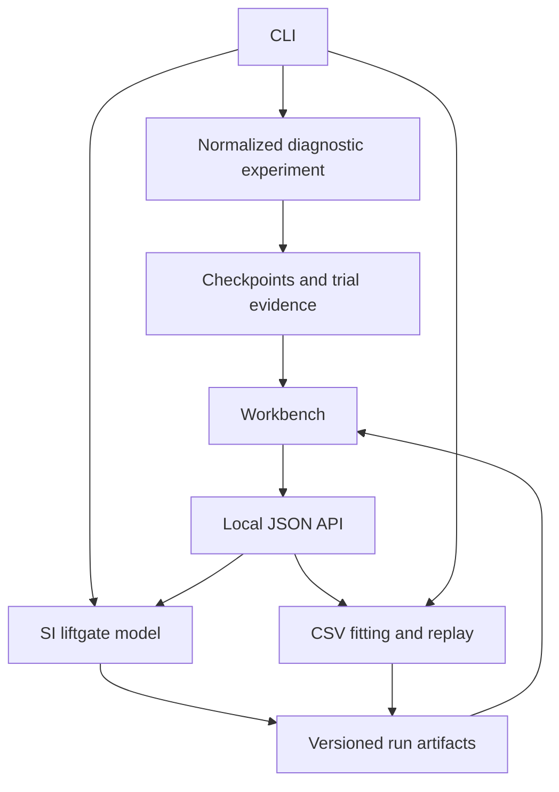

# Architecture and interfaces

The package retains the original `recursivecal.py` module so old experiments remain reproducible. New functionality is under `recursivecal_lab`. It can be installed as a wheel, used as Python modules, driven through `recursivecal`, or opened as a local workbench.

The SI model and normalized benchmark do not exchange physics or trained motor policies. Their artifacts carry different model identifiers. The Evidence view presents experiment outcomes; it does not run a training loop in JavaScript.

## Package boundaries

| Module | Responsibility |
| --- | --- |
| `physics.py` | Validated physical parameters, geometry, force balance, integration, scenarios, traces, and events |
| `measurements.py` | CSV contracts, source metadata, force fit, bounded application, and trajectory residuals |
| `experiments.py` | Frozen normalized dynamics, observed-feature policies, data partitions, evaluation, and evidence verification |
| `api.py` | JSON operation validation and temporary CSV ingestion |
| `server.py` | Foreground loopback HTTP transport and packaged static assets |
| `cli.py` | User commands, output selection, exit statuses, and error reporting |
| `io.py` | Strict JSON parsing and atomic output writes |
| `web/` | Responsive client, plots, trace playback, data import, and recorded-result inspection |

## HTTP contract

All operation requests use `Content-Type: application/json`. The API serves the browser on the same loopback origin. It has no authentication because it is not offered as a remote service. There is no generic file-read, shell, network fetch, or hardware-control operation.

| Method and path | Input | Result |
| --- | --- | --- |
| `GET /api/health` | None | Version, service status, hardware disconnected |
| `GET /api/capabilities` | None | Model defaults, parameter schema, scenarios, computation bounds, passive support calculation |
| `POST /api/simulate` | Parameters, controller parameters, provenance, scenario, duration, step, seed, initial state, limit behavior | `recursivecal.run/1` |
| `POST /api/fit-force` | `csv_text`, `metadata` | `recursivecal.force-fit/1` |
| `POST /api/apply-force-fit` | `fit`, optional `parameters` | `recursivecal.parameter-set/1` |
| `POST /api/replay` | `csv_text`, `metadata`, `simulation`, optional `acceptance_limits` | `recursivecal.trajectory-comparison/1` |

Input failures use HTTP 400 with `{ "error": "..." }`. Invalid origin or Host uses 403; unsupported media type uses 415; oversized requests use 413; more than two concurrent calculations uses 429. The body limit is 8 MiB and interactive simulation is limited to 50,000 integration steps. CLI simulation has the model's separately documented computation limit.

An eventful simulation still returns HTTP 200 because its trace is a valid result. The client must inspect `metrics.termination` and events. A completed API call is not a statement of physical adequacy.

## Extending the system

Changes to equations or reward definitions require a new model identifier and separately generated evidence. A measurement backend can supply files satisfying the data contract without modifying the simulator. Actual hardware integration would need a separately reviewed driver and independent physical safety system; this release contains neither a dummy driver presented as functional hardware nor an automatic actuation path.

The server never spawns training or long-running background jobs. Experiments run in the terminal. The workbench reads their completed summary artifacts. This keeps compute, model version, and outputs inspectable.

