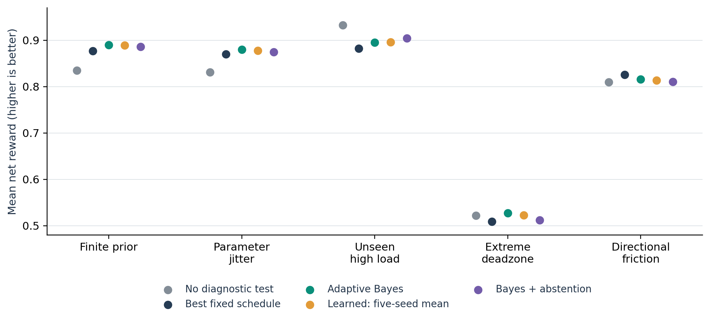
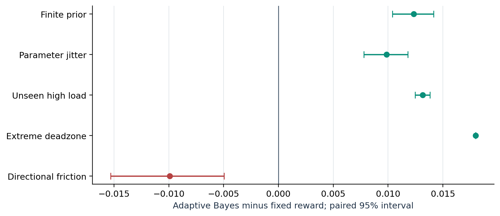
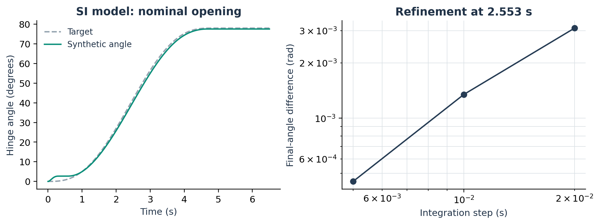
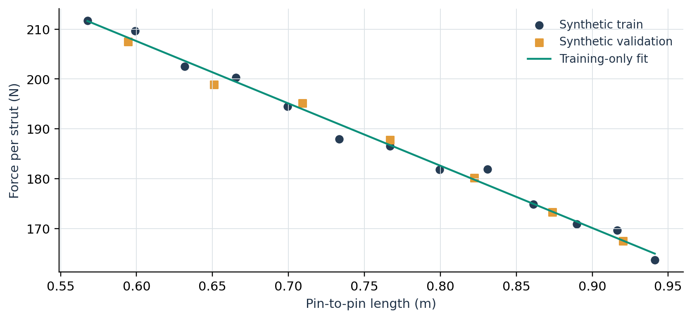

# Motivation and contribution

Calibration combines estimation with a decision about which measurement is worth acquiring. A diagnostic action can improve the final parameter choice, consume time or energy, or provide misleading evidence when the inference model is incomplete. A high average reward by itself does not establish that a policy learned to adapt its experiments. A fixed test can perform well on a restricted fault distribution, and a learned strategy can exploit assumptions that disappear outside that distribution.

RecursiveCal addresses this evaluation problem with executable controls and retained trial evidence. Its earlier neural pilot selected the same diagnostic probe on every reported held-out case. A fixed policy choosing that probe reproduced the rewards. That negative result motivated a deliberately observation-dependent task and stronger controls, rather than a claim of successful adaptive learning from the earlier scores.

The present release contributes three connected artifacts. First, it implements a restricted diagnostic benchmark with classical and learned policies, explicit costs, parameter and structural shifts, frozen train/validation/test streams, and checkpoint replay. Second, it provides a separate single-axis liftgate model in SI units with numerical verification and visible model-adequacy failures. Third, it implements a local workbench, strict CSV contracts, provenance-bearing force fitting, trajectory comparison, and versioned exports. These are software contributions and an exploratory empirical study. No novelty claim is made for the underlying learning or Bayesian design algorithms.

The experimental design follows the broader emphasis on sound baselines, selection procedures, uncertainty, and implementation sensitivity discussed by @patterson2024. @agarwal2021 likewise motivate reporting uncertainty rather than only point estimates. Those works guide evaluation practice; they do not establish the fidelity or significance of this particular simulator.

# Diagnostic decision problem

The normalized plant has hidden parameters for motor effectiveness, friction, load, damping, sensor bias, and a torque deadzone. The scalar reference implementation is retained from the earlier benchmark. Its acceleration is

$$
\ddot x = m\,\operatorname{sgn}(u)\max(0,|u|-d)
          - f\tanh(\dot x/0.035)-b\dot x
          -\ell\sin(\pi x/1.1).
$$

Here the variables and coefficients are normalized synthetic quantities, not the SI liftgate parameters. Six pulse probes use specified torques and fixture positions. A seventh reference measurement observes sensor bias. Pulse measurements contain displacement and final velocity with independent Gaussian noise of standard deviations 0.004 and 0.009. The reference measurement has standard deviation 0.006. Pulse displacements do not independently identify sensor bias, so the reference can change the terminal calibration choice.

The terminal action selects one of 150 legal calibrations. The simulator evaluates that choice on four fixed motion trajectories. Quality is an exponential transformation of the reference loss, which includes tracking, effort, final error, and numerical limit interventions. The recorded objective is

$$R=Q-0.012C,$$

where $C$ is diagnostic cost. A pulse costs 1.0 and the reference costs 1.5. At most two distinct tests can be used. The host evaluator owns true parameters and reward tables; action methods receive observed features only.

The task is deliberately short horizon. Adaptive methods share a low positive first pulse, then choose STOP or one of the six remaining probes. The final calibrator is common to the policies: it chooses the legal calibration with highest posterior expected quality under a ten-model bank. This isolates the second-test decision sufficiently to implement strong controls, but excludes adaptive choice of the first probe and longer diagnostic sequences.

The prior contains ten equiprobable synthetic hypotheses spanning nominal behavior, sensor bias, weak motor, high friction, and deadzone. Their complete parameter arrays are recorded in the run manifest. They were constructed to make different follow-up tests useful for different first observations. This design should not be mistaken for an empirical distribution of industrial faults.

# Experimental method

## Data separation and evaluation cohorts

The release run uses 1,024 training contexts, 512 validation contexts, and 512 cases in each of five test cohorts. Distinct deterministic random streams identify the partitions. Every policy receives the same generated observations for each evaluation case. Saved episode identifiers include partition, seed, and index.

Finite-prior test cases reuse the ten latent plant types with new observation noise. Thus their plant support intentionally overlaps training; this is a new-noise test, not unseen-plant validation. Continuous jitter perturbs parameters under the same equations. The high-load and extreme-deadzone cohorts extend specified parameter ranges absent from the prior. The fifth cohort changes the equations: positive-velocity friction is multiplied by $1+a$ for $a$ uniformly distributed between 0.5 and 1.2, while negative-velocity friction remains unchanged. This breaks the reference model's mirror symmetry. The inference bank remains symmetric.

The structural shift affects both probe observations and terminal quality. It is a specified synthetic stress case, not an observed real failure distribution. Exact seeds, ranges, noise, candidate calibrations, and model arrays are retained with the evidence.

This study is exploratory. Earlier outcomes and development smoke tests were inspected while constructing the software. In the final runner, schedule selection, mismatch threshold, and learned checkpoints are fixed before test generation, but that execution order does not make an iteratively developed public benchmark independently preregistered or blinded.

## Classical policies and cost controls

The no-probe policy selects the prior-optimal calibration without collecting data. It is not necessarily a factory setting or an unchanged deployed controller. The fixed-schedule method ranks 29 zero-, one-, and two-test schedules on training contexts, then selects among the best five on validation. The selected schedule is the low positive pulse followed by the sensor reference. A separate forced-two fixed control is retained.

The adaptive Bayesian policy evaluates the expected terminal quality after each permitted second action, subtracts its test cost, and compares it with stopping. A tensor-product Gauss-Hermite rule integrates the Gaussian observation likelihood under the finite posterior. The primary full run uses order 15. Orders 5 and 9 are recorded for sensitivity, and validation resolution results are saved. This is a numerical approximation to expected utility, not an exact continuous-observation optimum. Small differences from learned policies should be interpreted in light of that approximation.

The forced-two Bayesian control removes STOP. Equal probe counts do not imply equal total cost because the reference is more expensive. We therefore retain quality, cost, number of probes, and net reward separately. An additional shuffled control permutes a policy's chosen second actions across test cases and recomputes the posterior using each case's assigned measurement. It preserves aggregate action frequencies and total diagnostic cost while breaking the observation-action association. Individual paired cases can still have different costs.

## Learned policy

The learned method is a contextual bandit with finite-context replay. Its input has twelve features: two scaled observed pulse readings and ten scaled posterior weights. A 48-unit tanh layer maps these features to seven action values. Training uses Adam with learning rate 0.0015, 700 minibatch updates, and epsilon-greedy exploration decreasing from 0.55 to 0.10. The chosen action's reward is scaled as $(R-0.8)10$ for squared-error regression.

The host precomputes reward tables for computational efficiency, but only the selected action's target enters each gradient update. Repeated visits to one context can sample different action rewards. This is not fresh online hardware interaction. Every 50 updates, validation reward is evaluated; the highest validation mean selects the checkpoint, with earlier checkpoints winning ties. Five independent learner seeds are retained: 13, 37, 103, 211, and 509.

Checkpoints are saved as JSON weights and reloaded before evaluation. Artifact verification reconstructs features from saved first observations and reproduces the selected learned actions. Information-boundary tests alter hidden parameters, reward tables, and unobserved probe values while checking that a fixed policy's actions and observed-data posterior decisions remain unchanged.

## Mismatch fallback and uncertainty

The mismatch statistic is the minimum noise-standardized distance between the first observation and any prior prediction. Its threshold is the higher empirical 95th percentile on validation contexts, fixed before test generation. A flagged case stops and uses the prior-optimal calibration, paying for the first test already performed. This is an explicit fallback policy, not a certified safeguard or a guaranteed known-good controller.

Unshuffled policy contrasts use paired case differences with 2,000 percentile bootstrap resamples. Their 95% intervals condition on a particular fitted policy and the specified synthetic population. They exclude uncertainty from choosing the benchmark, physics assumptions, and hyperparameter development. Learned seed means and their sample standard deviation are reported separately. Five seeds do not justify broad claims about training reliability.

Single-permutation shuffled controls are descriptive. Their rows share an action permutation, so ordinary independent-row bootstrap intervals would omit dependence and permutation uncertainty. The released summary explicitly records null inferential intervals for those contrasts. Multiple policy and cohort comparisons are exploratory, without a familywise multiplicity correction.

# Diagnostic results

Table 1 reports mean net reward. The learned column averages the five trained seed means, rather than treating all seed-by-episode outcomes as independent training runs.

| Cohort | No probe | Fixed | Bayes | Learned mean | Bayes + fallback |
|:--|--:|--:|--:|--:|--:|
| Finite prior | 0.835115 | 0.877108 | 0.889437 | 0.889164 | 0.885895 |
| Continuous jitter | 0.831377 | 0.870065 | 0.879933 | 0.877946 | 0.874278 |
| Unseen high load | 0.932925 | 0.882169 | 0.895317 | 0.895957 | 0.904224 |
| Extreme deadzone | 0.522092 | 0.509154 | 0.527154 | 0.522354 | 0.512011 |
| Directional friction | 0.809727 | 0.825827 | 0.815906 | 0.813475 | 0.810208 |

Under the finite prior, Bayes improves on the fixed schedule by 0.012329, with interval [0.010389, 0.014152]. Its mean terminal quality is 0.910015 against 0.907108, while mean diagnostic cost falls from 2.5 to 1.714844. Therefore the reward gain combines quality and cost effects. The Bayesian policy stops after the first pulse on 237 of 512 cases and uses the reference on 182; its other choices include stronger or negative pulses.

The five learned finite-test means range from 0.888518 to 0.890010. Their mean is 0.889164 and sample standard deviation is 0.000572. Every learned-versus-Bayes paired interval includes zero. This supports useful observation-dependent behavior in the constructed setting without establishing learned superiority over the strong classical baseline. A nonsignificant difference is also not a formal equivalence result.

On finite-prior cases, Bayes exceeds its matched-frequency shuffled control by 0.024804 in descriptive mean reward at exactly equal aggregate diagnostic cost. This supports the relevance of assigning actions to observations, rather than merely learning a favorable global action mix. The single-permutation result has no inferential confidence interval.

The high-load result demonstrates a different failure. No diagnostic test scores 0.932925, versus 0.895317 for adaptive Bayes. Bayes minus no-probe is -0.037608 with interval [-0.039691, -0.035485]. The fallback improves Bayes to 0.904224 but remains below the no-probe control. Its flag rate is 34.77%, leaving many high-load cases unflagged. A first-measurement mismatch threshold does not reliably establish that the chosen model is adequate.

Under directional friction, the selected fixed schedule scores 0.825827 against Bayes at 0.815906. Bayes-minus-fixed is -0.009921, interval [-0.015302, -0.004964]. The learned mean is lower still at 0.813475. Observation-dependent selection can therefore be harmful when a structural assumption used by the inference model fails.

The extreme-deadzone cohort illustrates why raw quality and cost are retained. Bayes stops after its first test, giving the same quality as the fixed schedule while avoiding its reference cost. Two learned seeds take an unnecessary extra pulse and lose exactly 0.012 relative to the stopping seeds. The fallback worsens the mean to 0.512011, despite flagging 92.97% of cases. A high mismatch detection rate alone does not imply a useful fallback decision.

## Descriptive inference cost

A separate timing artifact uses 64 identical saved first observations, the seed-13 checkpoint, two warmups, and seven repetitions on the shared CPU environment. Median batch-amortized learned selection including feature preparation is 5.35 microseconds per case; Bayesian order-15 selection including its posterior is 1,860.88 microseconds. The median across repeated scalar loops is 73.10 and 2,286.46 microseconds per call, respectively. Training, model-bank construction, terminal calibration, and I/O are excluded from both measurements.

These values describe these implementations on an AMD EPYC 7763 environment with NumPy 2.3.5 and its recorded OpenBLAS configuration. They are not worst-case latency guarantees or a general speed benchmark. The two policies agree on only 67.19% of that batch's second actions, so the timing difference does not establish equal decision quality. Its practical implication is limited: amortizing diagnostic selection may be computationally useful, but policy quality and model adequacy remain separate questions.

# Separate physical-unit model and data path

The SI model represents a single hinged hatch with two identical struts. It uses illustrative repository CAD mounts, assumed mass and inertia, a linear force-length relation, a fixed absolute-temperature multiplier, Coulomb friction and stiction, viscous damping, bounded actuator force with first-order lag, and inelastic hard stops. It is not used to generate the normalized benchmark scores.

For hinge angle $q$, strut length $L(q)$, inertia $J$, motor force $F_m$, and gas force $F_g$ per strut, the model uses

$$J\ddot q=2(F_m+F_g)L'(q)-mgr_c\sin(q+q_c)-\tau_{ext}
-\tau_{friction}-2c_s[L'(q)]^2\dot q.$$

The moment arm is the analytic derivative of pin-to-pin length. The controller uses nominal feedforward and position/velocity feedback. A changed plant does not silently change its feedforward model; identified controller parameters must be supplied separately. No electrical current, battery energy, backlash, flexible-body dynamics, obstacle contact, or anti-pinch performance is modeled.

The integrator uses an analytic motor-lag update, midpoint geometry and torque prediction, a dissipative friction projection, and an average-velocity position update. Switching and damping generally limit overall accuracy to first order. It shortens the final step to the requested time and splits at power-loss events. A configured speed breach terminates the simulation with an explicit event. Detection at recorded states does not constitute a continuous-time safety guarantee.

Numerical checks give a maximum mount-derivative discrepancy of $4.90\times10^{-11}$ m and a constant-force virtual-work residual of $6.86\times10^{-7}$ J. Final-angle differences from the 2.5 ms reference at 2.553 s are 0.003094, 0.001346, and 0.000452 rad for 20, 10, and 5 ms steps. In a separate frictionless contact-free case, energy drift decreases from 0.013779 J at 20 ms to 0.000215 J at 2.5 ms. These checks establish implementation consistency and refinement behavior for the tested cases, not physical accuracy.

The nominal opening simulation completes 6.5 s with tracking RMSE 1.07157 degrees. At 78 degrees, the assumed struts produce 68.85 Nm of opening torque against 134.60 Nm of closing gravity torque. After the assumed 8 Nm static-friction capacity, 57.75 Nm of additional holding capacity is required. The default unpowered case falls and reaches its configured speed limit after 0.27 s. An explicitly modeled 70 Nm holding brake prevents drift in that synthetic case. It is an architecture change, not evidence of a real brake.

The NHTSA investigation of Toyota Sienna power liftgates documents one architecture in which the motor disengages at full opening and gas struts provide support [@nhtsa2008]. It motivates this architecture-dependent hold test. Its measured values are not used as labels for RecursiveCal's different geometry, and it does not imply that every powered liftgate must rely on gas struts alone.

The implemented data path accepts strict SI CSVs with source declarations and file hashes. A force curve is fit on explicit training rows, evaluated on separate validation rows, and applied to geometry only within its observed training-length range. Trajectory comparison interpolates a saved simulation at observed timestamps without refitting, time alignment, or extrapolation. Optional acceptance thresholds are recorded; without a threshold, the result is unevaluated rather than a fabricated pass.

The included force example has held-out RMSE 1.12368 N per strut. A separate synthetic trajectory sample has angle RMSE 0.001302 rad against the simulator. Because both examples share their generating assumptions with the implementation, neither independently validates physical behavior. Declaring imported coefficients measured also leaves subsequent generated motion labeled synthetic.

# Software and reproducibility

The MIT-licensed package provides a foreground CLI, loopback-only workbench API, packaged web assets, simulation and CSV exports, measurement fitting and replay, experiment execution, and artifact verification. The browser presents live local calculations separately from recorded examples. No cloud account, paid API, or GPU is required for the new suite. Historical optional Torch and Verifiers paths remain separate.

The diagnostic release contains 51,200 policy-by-case rows, 2,560 distinct evaluation cases, five learned checkpoints, train/validation arrays, saved observations, selection records, protocol bytes, and source/runtime hashes. The verifier reconstructs aggregate results, checks paired identities and finite values, and replays learned choices from saved observations. Hash verification protects integrity but is not an independent scientific replication.

The frozen scalar benchmark and historical CAD simulator remain unchanged. Earlier result JSONs are preserved. Repaired historical entrypoints have explicit paths and corrected duration accounting; the historical low-pulse rounding behavior remains documented. The new SI model uses a separate identifier and does not retroactively change old scores.

Unit and integration tests cover model equations, geometry identities, refinement, data validation, held-out fitting, policy information boundaries, model shifts, checkpoint replay, artifact corruption, CLI behavior, and real HTTP requests. Browser acceptance tests cover interactive calculations, export, fitting and application, replay, error handling, recorded mode, and responsive layout. CI checks clean wheel installation against supported Python and NumPy versions. Software test success is kept distinct from the deliberately failing default passive-support condition.

# Limits and publication scope

The finite hypothesis bank, fixed first probe, two-stage horizon, discrete calibration grid, and designed noise model make classical inference particularly strong. The learned policy shares a Bayesian terminal calibrator and posterior features. Its results do not show that a model-free method independently learned physical identification or low-level control.

The benchmark's original numerical timing remains imperfect: a 0.55-second low pulse becomes 0.56 seconds at a 20 ms step. Its equations are frozen for reproducibility, while the separate SI model implements exact final duration. Future changes to benchmark timing require a new model version and complete reevaluation. The present numerical limitations are part of the result, not concealed by a new UI.

Model misspecification is only sampled through a few specified synthetic shifts. The mismatch statistic has no distribution-free coverage or regret guarantee, and its prior-optimal fallback can be harmful. Stronger conclusions would require a broader benchmark designed independently of these results, more training seeds where relevant, and an independent replication.

No hardware measurements were acquired, no physical I/O adapter was implemented, and no vehicle was controlled. Physical accuracy, transfer of the normalized learned policy to the SI model, anti-pinch safety, real-time hardware-in-the-loop operation, and certification remain unestablished. The released measurement protocol defines the independent acquisitions and held-out comparisons needed to support a later physical claim. Those evidence requirements cannot be satisfied by additional synthetic runs alone.

# Conclusion

RecursiveCal is an executable workbench for studying diagnostic selection while keeping implementation, statistical evidence, and physical validity distinct. Adaptive policies improve the deliberately constructed finite-prior task, yet a structural friction change makes a fixed schedule better. The learned contextual bandit is competitive in the narrow synthetic setting without an established advantage over Bayesian experimental design. A separate SI mechanism and data-ingestion path expose support failures and numerical assumptions rather than treating a plausible visualization as validation. The release provides inspectable code and artifacts for further research, with the limits of each claim stated alongside its evidence.

# Availability

Repository: <https://github.com/Venkat-RJ/RecursiveCal>. The exact files used are under `research/releases/v0.3`, `research/releases/physical-v1`, and `research/releases/inference-v0.3`. The experiment manifest and audit record source hashes. Figures are generated by `scripts/build_paper.py` from those artifacts. This document is a working draft for author review and has not been submitted to a venue or independently peer reviewed.

# References

::: {#refs}
:::

